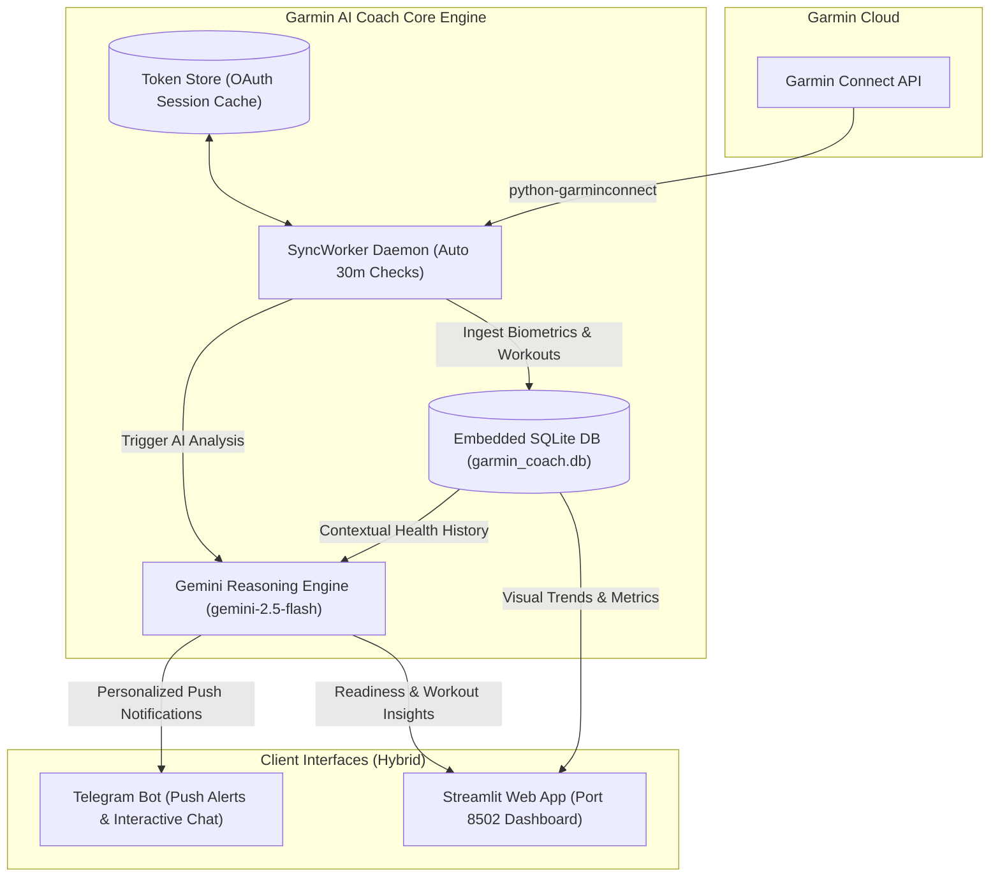

<div align="center">

# 🏃‍♂️ Garmin AI Coach

**Personalized, AI-powered endurance and recovery coaching powered by Garmin Connect & Google Gemini.**

[](https://opensource.org/licenses/MIT)
[](https://www.python.org/)
[](https://www.docker.com/)
[](https://streamlit.io/)
[](https://aistudio.google.com/)

[Getting Started](docs/GETTING_STARTED.md) •
[Architecture](docs/ARCHITECTURE.md) •
[Telegram Setup](docs/TELEGRAM_SETUP.md) •
[Multi-User Setup](docs/MULTI_USER.md)

</div>

---

## 🌟 Highlights

**Garmin AI Coach** ingests your health biometrics (Sleep stages, HRV status, Body Battery, Resting Heart Rate) and completed workouts from **Garmin Connect**, providing intelligent, context-aware training guidance via **Streamlit** and **Telegram**.

Instead of isolated numbers, it correlates your **acute workout strain** with your **overnight autonomic recovery** and **14-day baseline**, acting as an elite sports physiologist in your pocket.

* **🌅 Morning Readiness Briefing:** Synthesizes sleep quality, HRV balance, and Body Battery into an actionable training readiness verdict every morning.
* **🏃‍♂️ Post-Workout Breakdown:** Analyzes completed runs, rides, trails, racket matches, and gym sessions against your recovery status.
* **👥 Multi-Athlete / Household Ready:** Supports multiple Garmin accounts under one installation (ideal for couples or training partners) with isolated Telegram push notifications and a dashboard profile switcher.
* **🔒 Privacy-First & Local Storage:** All biometrics are stored locally in an embedded SQLite database. OAuth session tokens are cached securely and never committed to version control.
* **⚡ Resilient AI Pipeline:** Powered by **Google Gemini** with automated model fallback (`gemini-2.5-flash` $\rightarrow$ `gemini-1.5-flash` $\rightarrow$ `gemini-2.0-flash`) for fast, cost-effective inference.
* **💬 Conversational Coach:** Ask your coach questions anytime via Telegram (`/coach ...`) or through the Streamlit interactive chat.

---

## 🎯 Sport-Specific Intelligence

The coach adapts its physiological analysis depending on the sport:

| Sport | Key Metrics Analyzed |
| :--- | :--- |
| **Running & Cycling** | Heart Rate Zones (Z2 base vs Z4 threshold), Aerobic Decoupling, Cadence, Aerobic/Anaerobic Training Effect (TE). |
| **Trail Running & Hiking** | Cumulative Elevation Gain ($D+$), Grade Adjusted Pace, Eccentric Muscular Fatigue on descents. |
| **Tennis & Pickleball** | Intermittent High-Intensity Sprints, Rotational Torque, Anaerobic Bursts, Neuromuscular Fatigue. |
| **Strength Training** | Central Nervous System (CNS) strain, rest intervals, and nocturnal HRV recovery response. |

---

## 📸 Architecture Overview



---

## 🚀 Quick Start (Docker)

### 1. Clone & Configure
```bash
git clone https://github.com/your-username/garmin-ai-coach.git
cd garmin-ai-coach

cp .env.example .env
cp config/users.yaml.example config/users.yaml
```

1. Edit `.env` to add your **`GEMINI_API_KEY`** (free from [Google AI Studio](https://aistudio.google.com/)) and **`TELEGRAM_BOT_TOKEN`**.
2. Edit `config/users.yaml` with your athlete name, sports, and Garmin credentials.

### 2. First-Time Authentication (MFA Handshake)
Run the interactive CLI tool to authenticate with Garmin Connect and handle any 2FA/MFA verification codes:

```bash
pip install -r requirements.txt
python -m src.cli.login --user athlete_1
```
*(Session tokens are saved to `data/tokens/athlete_1/tokens.json`. You will not need to authenticate manually again.)*

### 3. Launch with Docker Compose
```bash
docker compose up -d --build
```

Access the Web Dashboard at **[http://localhost:8502](http://localhost:8502)**!

---

## 🤖 Telegram Bot Commands

| Command | Description |
| :--- | :--- |
| `/readiness` | Get today's morning readiness score, HRV status, and AI coaching verdict. |
| `/workout` | Detailed breakdown of your latest completed activity. |
| `/coach <question>` | Ask training or recovery advice tailored to your recent biometrics. |
| *Plain Text* | Ask any question directly to your AI Coach. |

---

## 📂 Project Structure

```
garmin-ai-coach/
├── config/
│   ├── config.yaml.example   # Global system settings
│   └── users.yaml.example    # Multi-athlete setup template
├── data/                     # Mounted volume (ignored in git)
│   ├── tokens/               # OAuth session cache per athlete
│   └── garmin_coach.db       # Embedded SQLite database
├── docs/
│   ├── ARCHITECTURE.md       # Detailed technical design
│   ├── GETTING_STARTED.md    # Step-by-step setup guide
│   ├── TELEGRAM_SETUP.md     # Telegram BotFather walkthrough
│   └── MULTI_USER.md         # Multi-account configuration
├── src/
│   ├── ai/                   # Gemini client & prompt templates
│   ├── bot/                  # Telegram bot service & handlers
│   ├── cli/                  # Interactive MFA login utility
│   ├── collectors/           # Garmin Connect API ingestion & daemon
│   ├── database/             # SQLite schema and query layer
│   ├── web/                  # Streamlit dashboard application
│   ├── config.py             # Configuration loader
│   └── main.py               # Unified multi-thread runner
├── compose.yaml              # Docker Compose configuration
├── Dockerfile                # Production container specification
├── requirements.txt          # Python dependencies
└── README.md
```

---

## 🔒 Security & Privacy

* **No Secrets in Version Control:** `.env` and `config/users.yaml` are strictly ignored by `.gitignore`.
* **Token Caching:** Passwords are used once during the initial interactive CLI login; all subsequent requests use rotating OAuth session tokens.
* **100% Self-Hosted:** Data stays on your own machine or homelab server.

---

## 📄 License

This project is licensed under the [MIT License](LICENSE).
