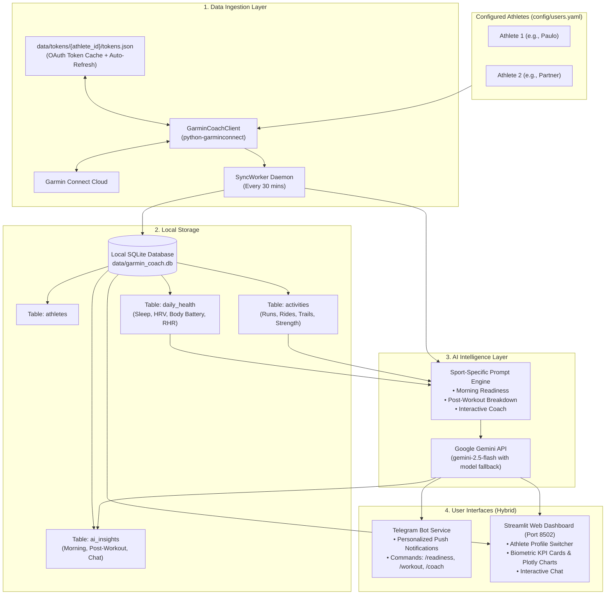

# 🏛️ Architecture & System Design — Garmin AI Coach

This document details the architectural components, data ingestion flow, database schema, and AI prompting mechanics of **Garmin AI Coach**.

---

## 1. High-Level System Architecture

---

## 2. Component Breakdown

### A. Garmin Ingestion Client (`src/collectors/garmin_client.py`)
- Employs `python-garminconnect` (v0.3+) using TLS impersonation (`curl_cffi`) to safely communicate with Garmin Connect.
- **Session Caching:** After initial login (or 2FA verification), session tokens are serialized into `data/tokens/{athlete_id}/tokens.json`. Subsequent syncs load the session from disk without repeatedly hitting Garmin's login endpoint.
- **Biometric Aggregation:**
  - **Sleep:** Overall sleep score, total sleep time, deep sleep, REM sleep, light sleep, and awake time.
  - **HRV:** Overnight average, 7-day baseline, and status (`Balanced`, `Unbalanced`, `Low`).
  - **Body Battery:** Morning wake value, daily charge, and daily drainage.
  - **Resting HR & Stress:** Daily resting heart rate and average stress level.
  - **Activities:** GPS distance, duration, elevation gain ($D+$), average/max heart rate, aerobic/anaerobic Training Effect (TE), cadence, and power.

### B. Storage Layer (`src/database/db.py`)
- Standard, lightweight **SQLite** file at `data/garmin_coach.db`.
- Requires zero external database maintenance (no PostgreSQL or Redis needed).
- Stores raw JSON alongside normalized columns for future flexibility.

### C. AI Intelligence Layer (`src/ai/`)
- Uses **Google Gemini** for high-speed, cost-effective inference with large context windows.
- Includes automated **model fallback** (`gemini-2.5-flash` $\rightarrow$ `gemini-1.5-flash` $\rightarrow$ `gemini-2.0-flash` $\rightarrow$ `gemini-1.5-pro`) to ensure resilience against rate limits.
- **Prompt Engineering:**
  - Connects physiological metrics (e.g. drop in overnight HRV, low REM sleep) with real-world athletic consequences (e.g. autonomic nervous system fatigue, reduced threshold endurance).
  - Adapts to the specific sport:
    - **Endurance (Running / Cycling):** Focus on cardiac decoupling, Zone 2 aerobic base, and threshold pacing.
    - **Trail Running / Hiking:** Focus on cumulative elevation gain ($D+$) and eccentric quadriceps load on descents.
    - **Racket Sports (Tennis / Pickleball):** Focus on rapid acceleration/deceleration, rotational torque, and intermittent anaerobic bursts.
    - **Strength Training:** Focus on central nervous system (CNS) strain and muscular recovery.

### D. Multi-Athlete Isolation
- Every athlete is uniquely identified by an `id` string (e.g., `paulo`).
- Data directories and database rows are separated by `user_id`.
- The Telegram Bot matches the sender's `chat_id` to the corresponding athlete, ensuring private, isolated coaching.
- The Streamlit Web UI features a profile switcher in the sidebar to toggle between household members with one click.
