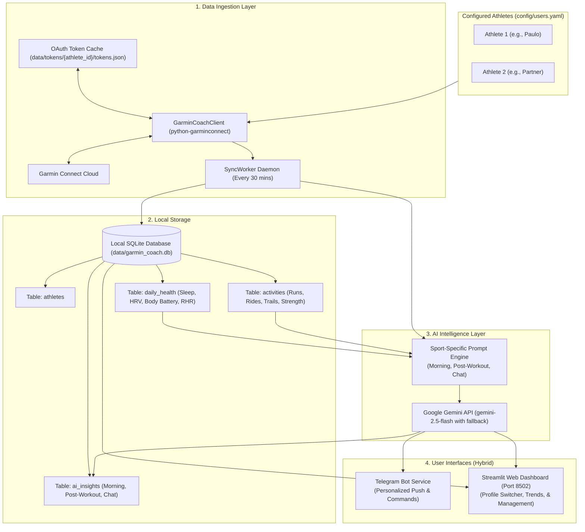
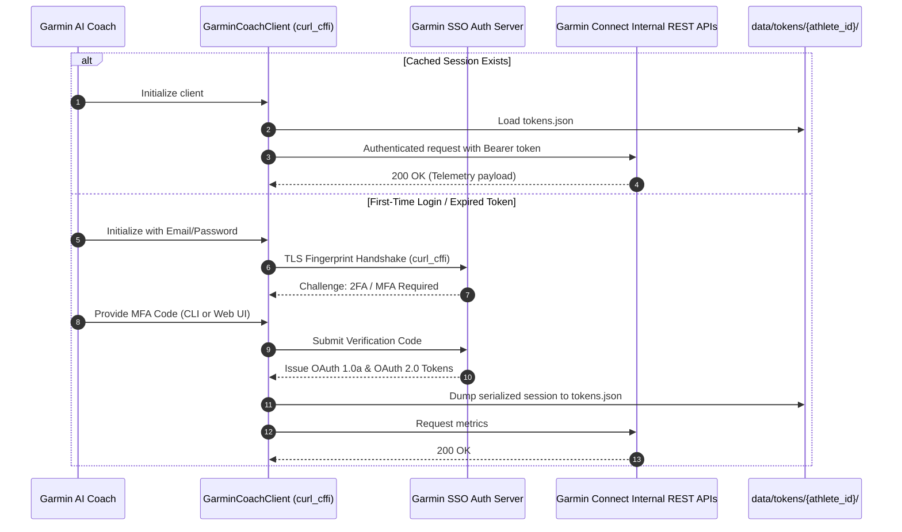
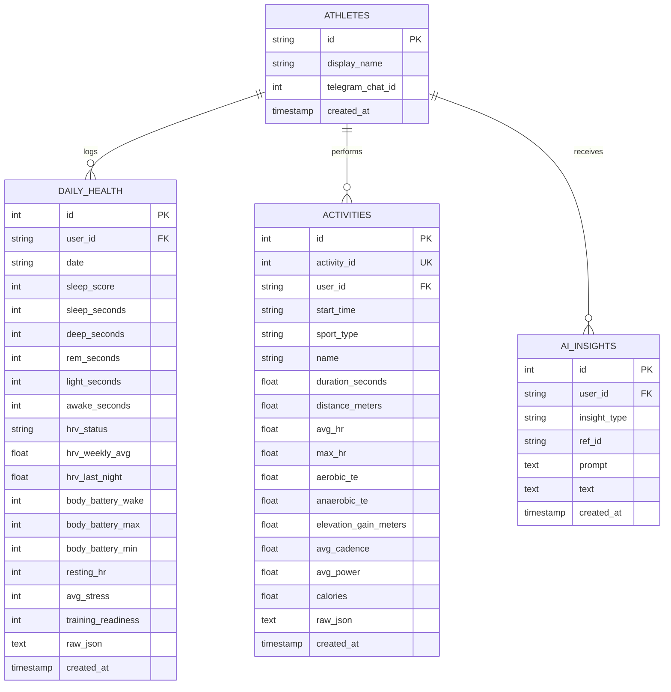
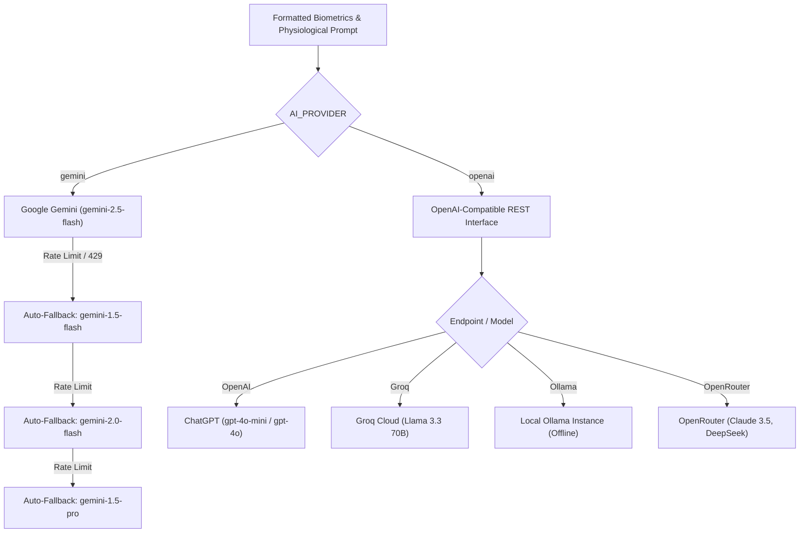

# 🏛️ Architecture & System Design — Garmin AI Coach

[← Back to Main README](../README.md)

This document provides a deep technical breakdown of the architecture, data ingestion mechanics, database schema, sports physiology reasoning engine, and delivery layers of **Garmin AI Coach**.

---

## 1. High-Level System Architecture



---

## 2. Deep Layer-by-Layer Architectural Breakdown

Click each collapsible section below to inspect the specifications, design patterns, protocols, and reference documentation for each architectural layer.

---

<details>
<summary><b>⚙️ Layer 1: Configuration & Athlete Management Layer</b></summary>

### Overview & Responsibilities
The Configuration Layer manages multi-tenancy, athlete preferences, secrets separation, and live profile updates without requiring application restarts.

* **Primary Files:**
  * [`src/config.py`](file:///C:/Users/paulo/OneDrive/%C3%81rea%20de%20Trabalho/DEV/garmin-ai-coach/src/config.py) — Configuration loader, schema normalizer, and YAML persistence helpers.
  * `config/users.yaml` — Declarative athlete registry (credentials, notification schedules, sports focus).
  * `.env` — Global runtime secrets (Gemini API key, Telegram Bot token, AI provider selection).

### Architecture & Security Patterns
1. **Separation of Secrets (12-Factor App):**
   * Global API keys reside exclusively in `.env`.
   * Per-athlete credentials reside in `config/users.yaml`.
   * Both files are explicitly gitignored to guarantee zero credential leakage.
2. **Dynamic Web Mutation:**
   * When an athlete edits their sports focus, language, or notification times via the Streamlit dashboard, `upsert_user_config()` re-serializes the configuration with `yaml.dump(..., sort_keys=False, allow_unicode=True)`.
   * Passwords remain masked in the UI; if the password field is left empty during an edit, the existing password is automatically preserved.
3. **Multi-Tenant Athlete Schema:**
   ```yaml
   users:
     - id: "unique_slug"               # Primary key string
       display_name: "Athlete Name"    # Presentation label
       garmin_email: "email"           # Garmin Connect account
       garmin_password: "pwd"          # Used once during initial token generation
       telegram_chat_id: 123456789     # Private push target
       morning_report_time: "07:00"    # Local 24h schedule
       send_morning_report: true       # Toggle readiness push
       send_activity_report: true      # Toggle post-workout push
       primary_sports: [...]           # Sports list for prompt calibration
       preferences:
         language: "pt-BR"             # Output language ("en" or "pt-BR")
         coaching_style: "balanced"    # Personality tuning
         unit_system: "metric"         # Metric vs Imperial
   ```

### Reference Documentation & Standards
* [The Twelve-Factor App: Config](https://12factor.net/config)
* [PyYAML Official Documentation](https://pyyaml.org/wiki/PyYAMLDocumentation)
* [Python-dotenv Documentation](https://github.com/theskumar/python-dotenv)

</details>

---

<details>
<summary><b>🔄 Layer 2: Ingestion & Garmin Sync Layer (Reverse Engineering & Networking)</b></summary>

### Overview & Responsibilities
The Ingestion Layer securely bridges Garmin's cloud telemetry with the local homelab environment. Because Garmin does not grant personal developers access to their official enterprise Health API, this layer uses an authenticated mobile Single Sign-On (SSO) client with browser TLS impersonation.

* **Primary Files:**
  * [`src/collectors/garmin_client.py`](file:///C:/Users/paulo/OneDrive/%C3%81rea%20de%20Trabalho/DEV/garmin-ai-coach/src/collectors/garmin_client.py) — Handles SSO handshake, MFA verification, token dumping, and metric extraction.
  * [`src/collectors/sync_worker.py`](file:///C:/Users/paulo/OneDrive/%C3%81rea%20de%20Trabalho/DEV/garmin-ai-coach/src/collectors/sync_worker.py) — Background scheduler, new activity detector, and event dispatcher.



### Technical Challenges & Solutions
1. **Cloudflare Antibot & TLS Fingerprinting:**
   * Garmin Connect protects its SSO and REST endpoints using Cloudflare bot management. Standard Python libraries like `urllib` or standard `requests` fail due to generic TLS fingerprints (JA3/JA4 signatures).
   * **Solution:** Under the hood, `python-garminconnect` leverages **`curl_cffi`**, which impersonates browser TLS extensions, cipher suites, and HTTP/2 settings indistinguishable from real desktop/mobile browsers.
2. **Session Persistence & Auto-Refresh:**
   * Passwords are used once. Successful logins produce serialized OAuth tokens stored in `data/tokens/{athlete_id}/tokens.json`.
   * Subsequent API calls read this file directly, bypassing credentials and avoiding rate-limiting.
3. **Internal Garmin API Endpoints Harvested:**
   * **Sleep:** `GET /wellness-service/wellness/dailySleepData/{calendarDate}` (sleep score, deep/light/REM/awake durations, SpO2, respiration).
   * **HRV:** `GET /hrv-service/hrv/{calendarDate}` (nightly average, 7-day baseline, status `BALANCED`/`UNBALANCED`/`LOW`).
   * **Body Battery & Stress:** `GET /wellness-service/wellness/dailyStressAdditions/{calendarDate}` (charged, drained, wake value).
   * **User Summary:** `GET /usersummary-service/usersummary/daily/{display_name}?calendarDate={calendarDate}` (resting heart rate, intensity minutes).
   * **Activities:** `GET /activitylist-service/activities/search/activities?start=0&limit={limit}` (splits, pace, elevation, heart rate zones, aerobic/anaerobic Training Effect).

### Reference Documentation & Links
* [python-garminconnect Repository (GitHub)](https://github.com/cyberjunky/python-garminconnect)
* [curl_cffi: Python binding for curl-impersonate (GitHub)](https://github.com/yifeikong/curl_cffi)
* [Reverse-Engineering Garmin Connect API Specs](https://theshravan.net/blog/how-to-use-the-unofficial-garmin-connect-api/)
* [Cloudflare TLS Fingerprint & Bot Detection Overview](https://developers.cloudflare.com/bots/)

</details>

---

<details>
<summary><b>💾 Layer 3: Storage & Data Persistence Layer (SQLite Engine)</b></summary>

### Overview & Responsibilities
The Storage Layer is responsible for persisting raw telemetry, normalized metrics, workout histories, and generated AI briefings locally with zero network latency and zero database administration overhead.

* **Primary Files:**
  * [`src/database/db.py`](file:///C:/Users/paulo/OneDrive/%C3%81rea%20de%20Trabalho/DEV/garmin-ai-coach/src/database/db.py) — Table definitions, transaction helpers, upsert queries, and rolling window aggregations.
  * `data/garmin_coach.db` — Embedded SQLite database file.

### Architectural Rationale: Why SQLite?
1. **Self-Hosted Homelab Simplicity:** No external Docker containers (like PostgreSQL or MariaDB) are required. A single file on disk simplifies backups, migrations, and minimizes RAM usage (~5MB).
2. **ACID Compliance & WAL Mode:** Handles concurrent reads from the Streamlit UI while the background SyncWorker writes incoming activities.
3. **Dual Storage Strategy (Normalized + Raw JSON):** Critical columns (e.g. `sleep_score`, `hrv_last_night`, `avg_hr`) are normalized for fast SQL querying and Plotly charting, while full payloads are archived in a `raw_json` column to ensure future metric additions require no schema migrations.

### Relational Schema Diagram (Entity-Relationship)



### Key Query Patterns & Deduplication
* **Daily Health Deduplication:** Enforced by `UNIQUE(user_id, date)`. Re-syncing the same day updates values in place without creating duplicate records.
* **Activity Deduplication:** Enforced by `UNIQUE(activity_id)`. The `SyncWorker` compares incoming Garmin activity IDs against stored IDs to trigger post-workout analysis *only once*.
* **Rolling Baselines:** Queries like `get_recent_daily_health(user_id, days=14)` power the AI prompt engine by comparing current-day biometrics against multi-day personal baselines.

### Reference Documentation & Standards
* [SQLite Official Documentation](https://www.sqlite.org/docs.html)
* [SQLite Write-Ahead Logging (WAL) Mode](https://www.sqlite.org/wal.html)
* [Python sqlite3 — DB-API 2.0 Interface](https://docs.python.org/3/library/sqlite3.html)

</details>

---

<details>
<summary><b>🧠 Layer 4: AI Intelligence & Sports Physiology Reasoning Layer</b></summary>

### Overview & Responsibilities
The AI Intelligence Layer translates raw biometric telemetries into scientifically grounded, contextual training and recovery advice.

* **Primary Files:**
  * [`src/ai/prompt_templates.py`](file:///C:/Users/paulo/OneDrive/%C3%81rea%20de%20Trabalho/DEV/garmin-ai-coach/src/ai/prompt_templates.py) — Domain-specific prompt engineering and system instructions.
  * [`src/ai/gemini_client.py`](file:///C:/Users/paulo/OneDrive/%C3%81rea%20de%20Trabalho/DEV/garmin-ai-coach/src/ai/gemini_client.py) — LLM provider orchestration, automatic model fallback, and OpenAI-compatible REST dispatcher.

### Exercise Physiology Framework Embedded in Prompts
The prompt templates enforce strict physiological correlation rules rather than returning generic wellness tips:
1. **Autonomic Nervous System (ANS) Balance:**
   * High nocturnal HRV (rMSSD) paired with elevated deep/REM sleep indicates parasympathetic dominance (readiness for high-intensity threshold or anaerobic training).
   * Depressed HRV relative to the 7-day baseline coupled with elevated resting heart rate indicates sympathetic dominance, systemic inflammation, or accumulated central nervous system (CNS) fatigue.
2. **Polarized Training Distribution (80/20 Rule):**
   * Correlates time in Zone 2 (aerobic mitochondrial base) vs Zone 4/5 (lactate threshold and VO2 max).
3. **Sport-Specific Calibration:**
   * **Running & Cycling:** Evaluates cardiac decoupling ($EF = \frac{\text{Pace/Power}}{\text{HR}}$), cadence, and training effect scores (0.0 to 5.0).
   * **Trail Running / Hiking:** Analyzes vertical meters ($D+$) and accounts for the severe eccentric muscular stress placed on the quadriceps during descents.
   * **Tennis & Pickleball:** Highlights anaerobic lactic bursts, rotational power, rapid decelerations, and neuromuscular strain.
   * **Strength Training:** Assesses CNS taxing from heavy compound lifts and correlates volume with subsequent nocturnal recovery.

### Multi-Provider Architecture & Resilient Fallback



### Reference Documentation & Physiological Research
* [Firstbeat Analytics Heart Rate Variability Science](https://www.firstbeat.com/en/science-and-physiology/epoc-and-training-effect/)
* [Dr. Stephen Seiler: The Polarized Training Model in Endurance Athletes](https://www.researchgate.net/scientific-contributions/Stephen-Seiler-39870020)
* [Google Gemini API Models & Quotas](https://ai.google.dev/gemini-api/docs/models/gemini)
* [OpenAI Chat Completions API Specification](https://platform.openai.com/docs/api-reference/chat)
* [Groq Cloud High-Speed Inference Engine](https://console.groq.com/docs)
* [Ollama Open-Source Local Models](https://ollama.com/)

</details>

---

<details>
<summary><b>📱 Layer 5: Presentation & Delivery Layer (Telegram & Streamlit UI)</b></summary>

### Overview & Responsibilities
The Delivery Layer serves insights through two complementary interfaces: proactive push notifications via **Telegram** for on-the-go alerts, and a rich interactive **Streamlit** dashboard for deep historical exploration.

* **Primary Files:**
  * [`src/web/app.py`](file:///C:/Users/paulo/OneDrive/%C3%81rea%20de%20Trabalho/DEV/garmin-ai-coach/src/web/app.py) — Web application, interactive athlete management, Plotly trend visualizer, and live coach chat.
  * [`src/bot/telegram_service.py`](file:///C:/Users/paulo/OneDrive/%C3%81rea%20de%20Trabalho/DEV/garmin-ai-coach/src/bot/telegram_service.py) — Telegram polling worker, markdown message chunker, and command dispatcher.
  * [`src/main.py`](file:///C:/Users/paulo/OneDrive/%C3%81rea%20de%20Trabalho/DEV/garmin-ai-coach/src/main.py) — Unified process coordinator launching daemon threads.

### Telegram Service Architecture
1. **Thread-Safe Long Polling:** Runs on a dedicated daemon thread without blocking the Streamlit UI or the sync worker.
2. **Chat ID Isolation:** Validates incoming messages against `config/users.yaml`. Only configured athletes receive responses, guaranteeing privacy.
3. **4096-Character Buffer Chunker:** Telegram rejects messages longer than 4096 characters. The delivery service splits long coach analyses into clean sequential blocks.
4. **Markdown Fallback:** If custom Markdown formatting fails due to unescaped special characters, the service automatically resends the message in plain text to ensure delivery never fails.

### Streamlit Web Dashboard Architecture
1. **Dual Navigation Modes:**
   * **Athlete Dashboard:** Metric KPI tiles, AI morning briefing, expandable workout cards, interactive Plotly charts (Sleep vs HRV, Resting HR vs Stress), and real-time chat with the coach.
   * **Manage Athletes:** Forms to add, edit, or delete athletes, plus an in-browser 2FA verification panel that handles in-flight authentication codes without opening a terminal.
2. **State Management (`st.session_state`):**
   * Preserves in-flight login sessions and MFA contexts between reruns.
   * Maintains interactive chat history during "Ask Your Coach" conversations.

### Reference Documentation & APIs
* [Telegram Bot API Official Reference](https://core.telegram.org/bots/api)
* [pyTelegramBotAPI (telebot) Documentation](https://github.com/eternnoir/pyTelegramBotAPI)
* [Streamlit Application Development Guide](https://docs.streamlit.io/)
* [Plotly Python Interactive Graphing Library](https://plotly.com/python/)

</details>

---

[← Back to Main README](../README.md)
