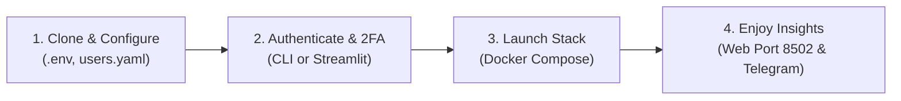

# 🚀 Getting Started with Garmin AI Coach

[← Back to Main README](../README.md)

This step-by-step guide will walk you through setting up **Garmin AI Coach** on your machine or server.



---

## Prerequisites

1. **Python 3.12+** (if running locally) or **Docker & Docker Compose** (recommended).
2. A **Google Gemini API Key** (Free tier available at [Google AI Studio](https://aistudio.google.com/)).
3. An active **Garmin Connect Account** with synced activities and sleep metrics.
4. *(Optional)* A **Telegram Bot Token** and your Telegram Chat ID (see [Telegram Setup Guide](TELEGRAM_SETUP.md)).

---

## 1. Clone the Repository

```bash
git clone https://github.com/your-username/garmin-ai-coach.git
cd garmin-ai-coach
```

---

## 2. Configuration Setup

### Step A: Configure Environment Variables
Copy `.env.example` to `.env`:

```bash
cp .env.example .env
```

Open `.env` in a text editor and enter your Gemini API Key and Telegram credentials:

```dotenv
GEMINI_API_KEY=AIzaSyD...your_real_gemini_key_here
TELEGRAM_BOT_TOKEN=123456789:ABCdefGhIJKlmNoPQRsTUVwxyZ
GEMINI_MODEL=gemini-2.5-flash
TIMEZONE=America/Sao_Paulo
SYNC_INTERVAL_MINUTES=30
```

### Step B: Configure Athletes in `users.yaml`
Copy `config/users.yaml.example` to `config/users.yaml`:

```bash
cp config/users.yaml.example config/users.yaml
```

Edit `config/users.yaml` with your athlete information:

```yaml
users:
  - id: "paulo"
    display_name: "Paulo"
    garmin_email: "paulo@example.com"
    garmin_password: "your_garmin_password"   # Used once during initial login
    telegram_chat_id: 123456789              # Your chat ID from @userinfobot
    morning_report_time: "07:00"
    send_morning_report: true
    send_activity_report: true
    primary_sports:
      - "running"
      - "cycling"
      - "trail_running"
      - "tennis"
      - "strength_training"
    preferences:
      language: "pt-BR"                      # "en" or "pt-BR"
      coaching_style: "balanced"
```

> [!NOTE]
> `config/users.yaml` is listed in `.gitignore` and will never be committed to Git.

---

## 3. First-Time Authentication & 2FA / MFA

Garmin Connect frequently requires Multi-Factor Authentication (MFA) via Email or SMS during the first connection. We provide a CLI utility to complete this interactive handshake:

```bash
# If using a virtual environment locally:
pip install -r requirements.txt
python -m src.cli.login --user paulo
```

1. The script connects to Garmin's Single Sign-On.
2. If prompted for MFA, check your email or phone for the code and enter it in the terminal.
3. The script validates the session, fetches a test reading of your biometrics, and saves persistent OAuth tokens in `data/tokens/paulo/tokens.json`.
4. From this point on, **you never need to enter your password or MFA again**—tokens refresh silently in the background!

---

## 4. Running with Docker Compose (Recommended)

Start the entire application (Web Dashboard + Ingestion Scheduler + Telegram Bot) with:

```bash
docker compose up -d --build
```

- **Web Dashboard:** Open [http://localhost:8502](http://localhost:8502) in your browser.
- **Logs:** View real-time sync logs with:
  ```bash
  docker compose logs -f
  ```

---

## 5. Running Locally (Without Docker)

You can run the unified stack directly with Python:

```bash
python -m src.main --mode all
```

Or run individual components:

* **Web Dashboard Only:** `python -m src.main --mode web`
* **Sync Scheduler Only:** `python -m src.main --mode worker`
* **Telegram Bot Only:** `python -m src.main --mode bot`
* **Single Sync Cycle & Exit:** `python -m src.collectors.sync_worker --once`

---

[← Back to Main README](../README.md)

