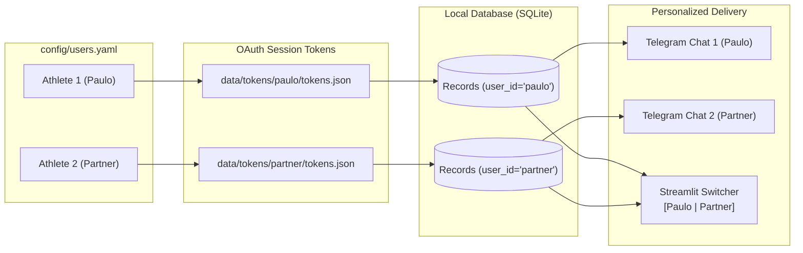

# 👥 Multi-User & Household Setup Guide

**Garmin AI Coach** is designed from the ground up to support multiple athletes within the same home or team (e.g. couples, training partners, or families where multiple people use Garmin watches).

---

## How Multi-User Isolation Works

1. **Configuration:** Every athlete is defined in `config/users.yaml` with a unique `id`.
2. **Tokens & Sessions:** Garmin OAuth tokens are cached in distinct directories:
   ```
   data/tokens/
   ├── athlete_1/
   │   └── tokens.json
   └── athlete_2/
       └── tokens.json
   ```
3. **Database Records:** All biometric records, workouts, and generated insights in SQLite are keyed by `user_id`.
4. **Push Routing:** Telegram alerts are routed independently using each athlete's specific `telegram_chat_id`. Athlete 1 never sees Athlete 2's alerts.
5. **Dashboard Switching:** In the Streamlit web app, a simple dropdown in the sidebar allows toggling between profiles.



---

## Configuration Example

In `config/users.yaml`:

```yaml
users:
  - id: "paulo"
    display_name: "Paulo"
    garmin_email: "paulo@example.com"
    garmin_password: "password1"
    telegram_chat_id: 111111111
    morning_report_time: "07:00"
    send_morning_report: true
    send_activity_report: true
    primary_sports:
      - "running"
      - "cycling"
      - "trail_running"
      - "tennis"
      - "strength_training"
    preferences:
      language: "pt-BR"
      coaching_style: "analytical"

  - id: "partner"
    display_name: "Partner"
    garmin_email: "partner@example.com"
    garmin_password: "password2"
    telegram_chat_id: 222222222
    morning_report_time: "07:30"
    send_morning_report: true
    send_activity_report: true
    primary_sports:
      - "running"
      - "strength_training"
    preferences:
      language: "pt-BR"
      coaching_style: "encouraging"
```

---

## Initial Authentication for Each Athlete

Authenticate each athlete interactively to generate their respective tokens:

```bash
# Authenticate Athlete 1
python -m src.cli.login --user paulo

# Authenticate Athlete 2
python -m src.cli.login --user partner
```

Once both have valid token files in `data/tokens/`, the background sync daemon will sync both accounts concurrently on each cycle!
