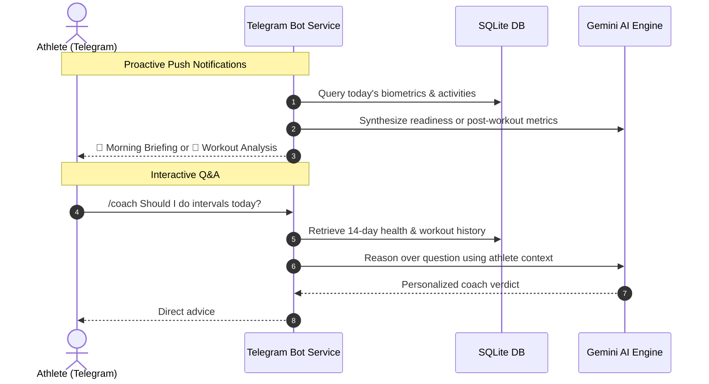

# 🤖 Telegram Setup Guide

[← Back to Main README](../README.md)

Setting up a private Telegram bot allows you to receive **automated morning readiness briefings**, **instant post-workout analysis**, and **ask questions directly to your AI Coach** while on the go.

---

## 1. Create Your Bot via @BotFather

1. Open Telegram and search for the official **`@BotFather`** (verified with a blue checkmark).
2. Start a conversation and send the command:
   ```text
   /newbot
   ```
3. Choose a friendly name for your bot (e.g., `My Garmin Coach`).
4. Choose a unique username that ends in `bot` (e.g., `paulo_garmin_coach_bot`).
5. **Copy the HTTP API Token** provided by BotFather (e.g., `123456789:ABCdefGhIJKlmNoPQRsTUVwxyZ`).
6. Paste this token into your `.env` file:
   ```dotenv
   TELEGRAM_BOT_TOKEN=123456789:ABCdefGhIJKlmNoPQRsTUVwxyZ
   ```

---

## 2. Retrieve Your Personal Chat ID

To ensure your health data remains completely private and only messages you:

1. In Telegram, search for the bot **`@userinfobot`**.
2. Press **Start**.
3. It will reply with your profile info. Copy the numerical value shown under `Id:` (e.g., `987654321`).
4. Paste this ID into `config/users.yaml` under your athlete entry:
   ```yaml
   users:
     - id: "paulo"
       display_name: "Paulo"
       telegram_chat_id: 987654321
   ```

---

## 3. Interacting with Your Coach



Once the bot service is running, open your new bot on Telegram and test the commands:

| Command | Action |
| :--- | :--- |
| `/start` | Displays welcome banner and confirms which athlete profile is linked to your chat. |
| `/readiness` | Shows today's sleep score, overnight HRV status, and the morning AI readiness briefing. |
| `/workout` | Reviews your most recent workout and the AI recovery breakdown. |
| `/coach <question>` | Ask any question (e.g., `/coach Should I do my threshold run today with my current HRV?`). |
| Any plain text | Treated as a direct question to your coach using your last 14 days of biometrics. |

---

## 4. Register Bot Menu Commands (Optional Polish)

To make Telegram display the command suggestions menu when you type `/`:

1. Message **`@BotFather`** on Telegram and type:
   ```text
   /setcommands
   ```
2. Select your newly created bot.
3. Paste the following block:
   ```text
   readiness - Today's sleep score, HRV & coach briefing
   workout - Breakdown of your latest workout
   coach - Ask training advice or recovery tips
   help - Show help and linked profile info
   ```

---

## 5. Troubleshooting & FAQ

* **The bot isn't sending messages to me:**
  * Telegram requires that you initiate a conversation first. Open your bot in Telegram and tap **Start** (or send `/start`).
  * Verify that the numeric `Id:` from `@userinfobot` exactly matches the `telegram_chat_id` in `config/users.yaml` or in the **Manage Athletes** tab in Streamlit.
* **Testing your Telegram connection immediately:**
  * Run: `python -m src.main --mode bot`
  * Send `/start` to your bot. If properly linked, it will reply: `Welcome back, Paulo! Your Garmin AI Coach is active.`

---

[← Back to Main README](../README.md)


